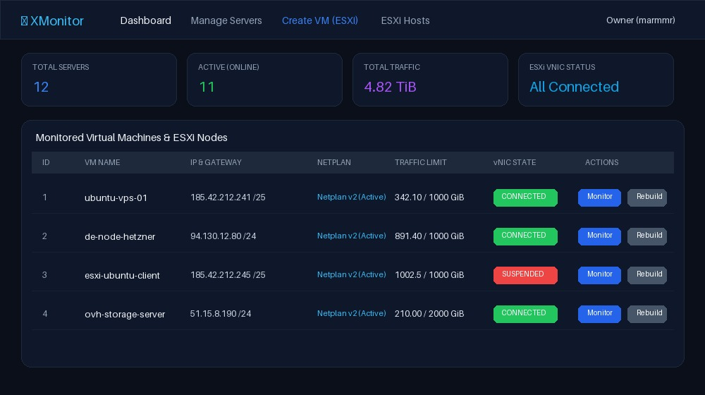

# XMonitor – Server Traffic Monitoring & ESXi Automation Panel

<div align="center">
  <br><br>
  
  &nbsp;
  
</div>

<div align="center"><br>
  <a href="README.fa.md"><strong>🇮🇷 برای مشاهده راهنمای کامل به زبان فارسی اینجا کلیک کنید</strong></a>
</div>

---

**XMonitor** is an enterprise-ready, lightweight Linux server traffic monitoring panel, ESXi virtualization automation system, and Telegram bot built with **Flask**, **SQLAlchemy**, **Paramiko**, and **Redis**.

It allows hosting providers, system administrators, and VPS resellers to automate Ubuntu virtual machine deployment on standalone **VMware ESXi** hosts, configure static networking via **Netplan**, monitor bandwidth consumption in real time using `vnstat`, and enforce hardware-level network suspension when bandwidth quotas are reached.

---

## Key Features

### 🚀 ESXi Virtualization & Automation
- **Automated Ubuntu VM Deployment:** Rapid thin-provisioned cloning from reference Golden Images using `vmkfstools -i`, dynamic `.vmx` hardware profile generation, and automated registration via `vim-cmd solo/registervm`.
- **One-Click VM Rebuild:** Re-clones the operating system disk from the template image in under 60 seconds without destroying VM registrations.
- **Hardware vNIC Traffic Suspension:** When a server reaches its bandwidth quota, the background worker automatically disconnects the virtual network card on ESXi (`vim-cmd vmsvc/device.connection <vmid> 4000 0`) rather than terminating the OS, preventing data loss.
- **Instant Network Un-suspension:** When an administrator or customer recharges bandwidth via the web panel or Telegram bot, the network interface is instantly reconnected (`connected = True`).
- **Complete IP & Netplan Management:** Supports primary IPv4, custom CIDR netmask, IPv4 gateway, IPv6 address and gateway, and multiple secondary (extra) IPs. Automatically generates and applies `/etc/netplan/01-netcfg.yaml` remotely via SSH.

### 📊 Real-Time Monitoring & Web Dashboard
- Multi-role access control: **Owner**, **Admin**, and **Customer/User**.
- Live resource monitoring: CPU cores & load, RAM usage, live network bandwidth (rx/tx in Mbps), disk space & read/write I/O, and ping latency.
- Historical traffic data charts powered by **Chart.js**.
- High-performance caching layer with **Redis**.
- Automated notifications via **Email (SMTP)** and **Telegram Bot**.

### 🤖 Telegram Bot Management
- Interactive inline keyboard interface.
- List active servers, real-time traffic usage, and network link statuses (`🟢 Connected` / `🔴 Suspended`).
- Bandwidth recharge command (`/recharge`) that re-enables network ports on the fly.
- Traffic limit configuration (`/setlimit`) restricted to the Owner.
- Broadcast announcements and support ticketing system.

---

## Project Structure

```text
X-monitoring/
├── app.py                     # Main Flask application (Web panel, APIs, and background monitor)
├── esxi_manager.py            # Standalone ESXi SSH automation engine & Netplan generator
├── worker.py                  # Background SSH monitoring worker & ESXi vNIC suspension handler
├── bot.py                     # Independent interactive Telegram Bot (python-telegram-bot)
├── db.py                      # SQLAlchemy database engine and session factory
├── models.py                  # ORM Models: Server, EsxiHost, TrafficSample, Event
├── migrate_sqlite_to_mysql.py # SQLite to MySQL migration script
│
├── templates/                 # Responsive Jinja2 HTML templates
│   ├── base.html              # Core application layout and RTL navigation
│   ├── dashboard.html         # User and admin dashboard with recharge actions
│   ├── manage_servers.html    # Server administration, IP settings, and rebuilds
│   ├── create_vm.html         # Comprehensive ESXi VM creation wizard
│   ├── esxi_hosts.html        # ESXi node connectivity and credential manager
│   ├── change_ip.html         # IP reallocation & live Netplan YAML previewer
│   └── ...
│
├── static/                    # CSS stylesheets, JavaScript files, and logos
│   ├── css/style.css
│   ├── js/script.js
│   └── img/logo.png
│
├── docs/                      # Documentation and screenshots
│   ├── images/                # Local screenshots (login.jpg, panel.jpg)
│   ├── INSTALL.md             # Local development setup guide
│   └── DEPLOYMENT.md          # Production deployment guide (Gunicorn, Nginx, Systemd)
│
├── .env.example               # Template environment configuration
├── config.example.json        # License configuration template
└── requirements.txt           # Python dependencies
```

---

## Installation & Quick Start

### 1. Prerequisites
- Python 3.10 or newer
- Redis server
- VMware ESXi 6.7 / 7.0 / 8.0 with SSH access enabled
- `vnstat` installed on monitored guest servers

### 2. Clone the Repository
```bash
git clone https://github.com/Unknown-sir/X-monitoring.git
cd X-monitoring
```

### 3. Create a Virtual Environment
```bash
python3 -m venv .venv
source .venv/bin/activate  # On Windows: .venv\Scripts\activate
pip install --upgrade pip
pip install -r requirements.txt
```

### 4. Configuration
Create `.env` and `config.json` from the provided templates:
```bash
cp .env.example .env
cp config.example.json config.json
```

Edit `.env` with your preferred settings:
```dotenv
SECRET_KEY=your_strong_random_secret_key
OWNER_PASSWORD=YourSecureOwnerPassword!
TELEGRAM_TOKEN=123456789:ABCdefGhIJKlmNoPQRsTUVwxyZ
ADMIN_CHAT_ID=your_telegram_chat_id
```

### 5. Launch Application
```bash
python app.py
```
Access the web panel at `http://localhost:5000`.

---

## License
This project is licensed under the MIT License.
